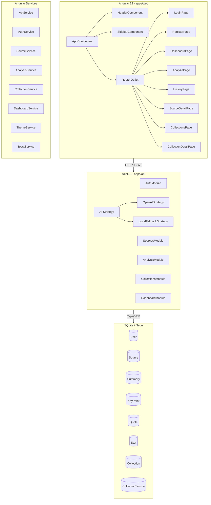

# Architecture — Content Whisperer

## System Architecture



## Data Flow

### Content Analysis Flow
```
User Input → AnalyzePage → POST /api/analysis/{text|url}
  → AnalysisController
    → AnalysisService (Strategy Pattern)
      → OpenAIStrategy (if key exists) or LocalFallbackStrategy (TF-IDF)
    → Save Source + Summary + KeyPoints + Quotes + Stats
  → Return Source with full analysis
  → SourceDetailPage renders all sections
```

### Auth Flow
```
Login/Register → AuthService.login/register
  → AuthController → AuthService
    → JWT token issued
  → Token stored in localStorage
  → ApiService adds Authorization header
  → JwtStrategy validates on every protected request
```

## Design Decisions

1. **AI Strategy Pattern**: Separates AI implementation (OpenAI vs LocalFallback) behind a common interface, allowing switch via env var without code changes.

2. **Separate detail tables**: Summary (1:1), KeyPoint (1:N), Quote (1:N), Stat (1:N) instead of JSON blobs — allows ordering, filtering, and future extensions (e.g., citable sources, rich queries).

3. **CollectionSource join table with UNIQUE constraint**: Prevents duplicate source assignments without application-level checks.

4. **Signal-first Angular**: All state managed via `signal()`/`computed()` — no RxJS complexity for local state. Async operations bridged via `lastValueFrom()`.

5. **Lazy routing**: Each page is a separate lazy chunk — initial bundle is only 91KB, each page adds 1.6-4.2KB.
